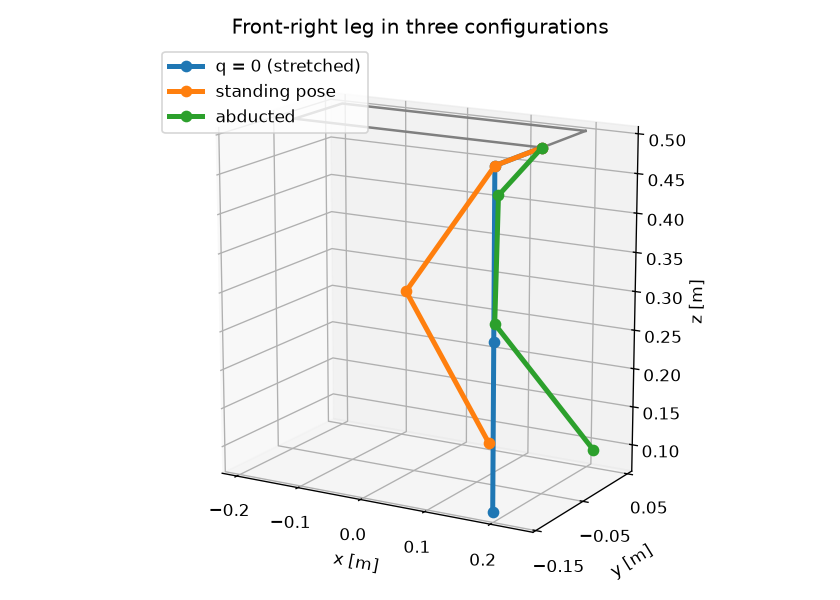
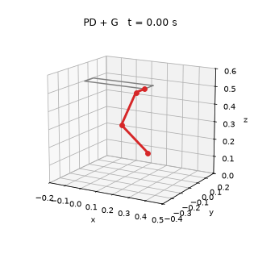

# Quadruped Leg Dynamics

Kinematics, dynamics and simulation of the front-right leg of a Unitree Go2–style quadruped, with the body fixed in place. The project has four parts:

- a closed-form kinematic model,
- a hand-built URDF,
- an Euler–Lagrange dynamics model,
- simulation in Drake.

Each part is cross-checked against [Pinocchio](https://github.com/stack-of-tasks/pinocchio).

<p align="center">
  
  
</p>

## Contents

| Part | What it does | Check |
|---|---|---|
| Forward kinematics ([`leg_model/kinematics.py`](leg_model/kinematics.py)) | Closed-form foot position $\mathbf p(q_1,q_2,q_3)$ from chained rotations $R_x(q_1)R_y(q_2)\ldots$ | Agrees with Pinocchio to $10^{-16}$ m over 1000 random configurations |
| URDF ([`urdf/front_right_leg.urdf`](urdf/front_right_leg.urdf)) | Body + hip / thigh / calf / foot from primitive shapes, solid-body inertias, transmissions for Drake | Inertias checked against the analytic formulas |
| Jacobian | Pinocchio frame Jacobian of the foot (`LOCAL_WORLD_ALIGNED`) | $\mathbf J\dot{\mathbf q} = \mathbf V$, and $\mathbf J_v$ vs. finite differences of the closed-form FK |
| Lagrangian dynamics ([`leg_model/planar_dynamics.py`](leg_model/planar_dynamics.py)) | SymPy derivation of $\mathbf M,\mathbf C,\mathbf G$ for the thigh–calf chain | Identical to Pinocchio's CRBA / RNEA to $10^{-16}$ |
| Simulation ([`leg_model/simulation.py`](leg_model/simulation.py)) | Headless Drake `MultibodyPlant` with a pluggable controller `tau(t, q, v)` | Gravity compensation holds the pose to $10^{-14}$ rad |

## Key results

PD control alone vs. PD + gravity compensation, with $K_p = 30$ and $K_d = 1$, target $\mathbf q_d = [0.3,\ 0.9,\ -1.8]$ rad:

| Controller | Steady-state error [rad] |
|---|---|
| PD | $[-0.020,\ 0.025,\ -0.018]$ — matches the prediction $\mathbf K_p^{-1}\mathbf G(\mathbf q)$ |
| PD + $\mathbf G(\mathbf q)$ | $\approx 0$ |

## Run

```bash
python -m venv .venv && source .venv/bin/activate
pip install -r requirements.txt
pytest -q                                   # 5 consistency tests
jupyter notebook notebooks/leg_kinematics_dynamics.ipynb
```

Tested with Python 3.13, Drake 1.58 and Pinocchio 4.1 (`pip install pin`) on macOS (arm64). Drake publishes wheels for Linux and macOS only. On Windows, use WSL.

## Repository layout

```
leg_model/        kinematics, Lagrangian dynamics, Drake simulation wrapper
urdf/             robot description
notebooks/        full walkthrough with derivations, plots and discussion
tests/            pytest consistency checks
media/            figures used in this README (regenerated by the notebook)
```

## Limitations

- Primitive geometry, with estimated masses and inertias.
- No joint friction, motor dynamics or torque saturation.
- The base is fixed, so there is no floating-base or foot-contact dynamics.

## License

MIT, see [LICENSE](LICENSE).
